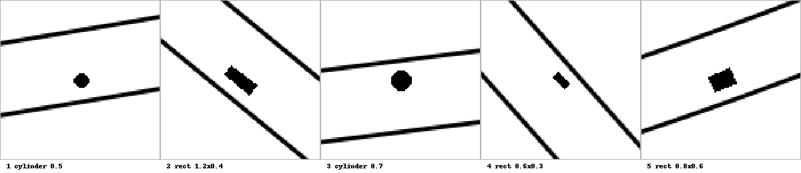

# Parte B: Sepang con 5 obstáculos

**[Español](#español) | [English](#english)**

---

<a name="español"></a>
# Español

Objetivo: agregar **5 obstáculos** a la pista de Sepang y que el robot dé **10 vueltas consecutivas sin colisión** con el controlador Follow the Gap (`gap_node`).

- El mapa original **no se modificó**: `Sepang_map.png` / `Sepang_map.yaml` siguen igual.
- Se creó un mapa nuevo: `Sepang_obs_map.png` / `Sepang_obs_map.yaml`.
- `gap_node` es el mismo de la parte anterior, sin cambios.

La instalación del entorno (ROS 2 Humble, F1TENTH gym, dependencias) está en el [README principal](README.md), pasos 1 a 3.


*Obstáculos en círculos rojos; línea verde = línea de inicio.*



*Detalle de cada obstáculo (de izquierda a derecha: 1 a 5).*

## 1. Cómo se agregaron los obstáculos

1. Se recorrió una vuelta completa de Sepang con `gap_node` y se guardó la trayectoria del carro (475 m por vuelta).
2. Se eligieron 5 puntos repartidos en la vuelta, en **rectas** (sin curvas cerradas) y lejos de la línea de inicio: a 76, 159, 224, 270 y 363 m desde la salida.
3. En cada punto se midió el ancho de la pista (unos 2.5 m) y se dibujó un obstáculo negro (ocupado) a **0.4 m de una pared**. Hay dos formas: **cilindros** (círculos vistos desde arriba) y **rectángulos** alineados con la pista, de distintos tamaños. Los lados se alternan para obligar al carro a cambiar de carril.
4. Cada obstáculo deja **entre 1.4 y 1.8 m** libres del otro lado para pasar (el carro mide 0.31 m de ancho).

| # | Forma | Tamaño (largo × ancho) | Centro (x, y) [m] | Lado de la pista | Paso libre |
|---|---|---|---|---|---|
| 1 | cilindro | Ø 0.5 m | (-9.70, -11.52) | izquierdo | 1.60 m |
| 2 | rectángulo | 1.2 × 0.4 m | (-9.56, -32.35) | derecho | 1.64 m |
| 3 | cilindro | Ø 0.7 m | (19.58, -10.80) | izquierdo | 1.42 m |
| 4 | rectángulo | 0.6 × 0.3 m | (35.33, 11.97) | derecho | 1.82 m |
| 5 | rectángulo | 0.8 × 0.6 m | (-31.50, 33.68) | izquierdo | 1.50 m |

"Izquierdo" y "derecho" son respecto al sentido de la marcha.

El mapa se genera con el script `src/f1tenth_gym_ros/maps/add_obstacles.py`, que lee el mapa original y escribe el nuevo:

```bash
cd ~/F1Tenth-Repository/src/f1tenth_gym_ros/maps
python3 add_obstacles.py
```

Para mover, agregar o cambiar los obstáculos, edita la lista `OBSTACLES` del script. Cada obstáculo es `(forma, x, y, dirección de la pista, largo, ancho)`, con forma `'cylinder'` (largo = diámetro) o `'rectangle'`. Luego ejecuta el script de nuevo.

## 2. Archivos

| Archivo | Descripción |
|---|---|
| `src/f1tenth_gym_ros/maps/Sepang_map.png` / `.yaml` | mapa original (sin cambios) |
| `src/f1tenth_gym_ros/maps/Sepang_obs_map.png` / `.yaml` | mapa con los 5 obstáculos |
| `src/f1tenth_gym_ros/maps/add_obstacles.py` | script que genera el mapa con obstáculos |
| `src/f1tenth_gym_ros/config/sim.yaml` | elige el mapa (`map_path`) |
| `docs/sepang_obs_preview.png` | imagen del mapa con los obstáculos marcados |
| `docs/sepang_obstacles_zoom.png` | detalle de cada obstáculo |
| `src/f1tenth_gym_ros/f1tenth_gym_ros/lap_visualizer.py` | dibuja en RViz la línea de inicio (verde) y las trayectorias del carro 1 (rojo) y del carro 2 (azul) |

## 3. Elegir el mapa con obstáculos

En `src/f1tenth_gym_ros/config/sim.yaml`, `map_path` debe terminar en `Sepang_obs_map` (sin extensión):

```yaml
map_path: '/home/<tu_usuario>/F1Tenth-Repository/src/f1tenth_gym_ros/maps/Sepang_obs_map'
map_img_ext: '.png'
sx: 0.0
sy: 0.0
stheta: 0.0
```

Para volver a la pista original, cambia el final a `Sepang_map`. Después de cualquier cambio en `sim.yaml` hay que recompilar:

```bash
cd ~/F1Tenth-Repository
source /opt/ros/humble/setup.bash
colcon build
source install/setup.bash
```

## 4. Correr la simulación y la prueba

**Terminal 1: simulador**

```bash
cd ~/F1Tenth-Repository
source /opt/ros/humble/setup.bash
source install/setup.bash
ros2 launch f1tenth_gym_ros gym_bridge_launch.py
```

Espera a que RViz muestre la pista con los obstáculos, el carro y la línea de inicio verde.

**Terminal 2: controlador**

El carro debe estar sobre la línea verde. Si no lo está, usa **2D Pose Estimate** en RViz: clic sobre la línea verde y arrastra hacia la derecha (+x).

```bash
cd ~/F1Tenth-Repository
source /opt/ros/humble/setup.bash
source install/setup.bash
ros2 run controllers gap_node
```

El carro da 10 vueltas y se detiene solo (unos 14 minutos). Al terminar, la terminal muestra el resumen con los datos de cada vuelta, la vuelta más rápida, la más lenta, el tiempo y la distancia total, la velocidad promedio y máxima, y las casi-colisiones.

En RViz, la trayectoria de la vuelta actual se dibuja en rojo y se reinicia en cada cruce de la línea de inicio.

### Con un segundo carro (obstáculo en movimiento)

En `src/f1tenth_gym_ros/config/sim.yaml` se activa el segundo carro y su pose inicial (4.5 m delante de la línea de inicio, en la recta principal). Después de cambiarlo, recompila:

```yaml
num_agent: 2
sx1: 4.5
sy1: 0.5
stheta1: 0.01
```

El segundo carro usa el mismo `gap_node`, con sus propios tópicos y una velocidad máxima de **2.3 m/s**, al menos un **60 % menor** que la del primer carro (unos 5.7 m/s de promedio). Así el primero lo alcanza y lo adelanta varias veces. Se necesitan 3 terminales (en cada una, `source install/setup.bash`):

```bash
# Terminal 1: simulador
ros2 launch f1tenth_gym_ros gym_bridge_launch.py
# Terminal 2: carro 1
ros2 run controllers gap_node
# Terminal 3: carro 2 (lento)
ros2 run controllers gap_node --ros-args -r __node:=opp_node \
  -p scan_topic:=/opp_scan -p odom_topic:=/opp_racecar/odom -p drive_topic:=/opp_drive \
  -p v_max:=2.3 -p v_min:=1.5 -p pace_initial_cap:=2.3
```

Con dos carros, el simulador solo avanza cuando **ambos** reciben comandos, así que hay que iniciar los dos nodos. En RViz, la trayectoria del carro 1 se dibuja en **rojo** y la del carro 2 en **azul**; cada una se reinicia cuando su carro cruza la línea de inicio.

### Criterio de aprobación

| Criterio | Objetivo |
|---|---|
| Vueltas | 10 consecutivas |
| Colisiones | ninguna (`Near-collisions: 0` en el resumen) |

## 5. Resultados

### 5.1 Dos carros, mapa con cilindros y rectángulos (20-nov-2026)

Prueba completa en el simulador con el mapa actual (2 cilindros y 3 rectángulos) y el segundo carro a 2.3 m/s como obstáculo en movimiento. Carro 1 con `gap_node` y sus parámetros por defecto.

| Criterio | Resultado |
|---|---|
| Vueltas consecutivas del carro 1 | **10/10** |
| Casi-colisiones (lectura del LiDAR < 0.20 m) | **0** |
| Contactos con paredes u obstáculos | **0** (verificado comparando la posición del carro con el mapa durante toda la prueba) |
| Choques entre los dos carros | **0** |
| Velocidad promedio carro 1 / carro 2 | 5.55 m/s / 2.27 m/s (el carro 2 es ~60 % más lento) |
| Vuelta más rápida | vuelta 10, 82.77 s |
| Vuelta más lenta | vuelta 1, 90.96 s |
| Tiempo / distancia total | 856.67 s / 4757.2 m |

El carro 1 alcanzó y adelantó al carro 2 varias veces. Los dos momentos de mayor acercamiento fueron adelantamientos lado a lado, a 0.60 m entre centros (unos 0.3 m de espacio entre los carros):

| Tiempo | Lugar (x, y) | Carro 1 | Carro 2 |
|---|---|---|---|
| 9 s | recta principal (18.0, 0.6) | 3.8 m/s | 2.3 m/s |
| 158 s | (-30.5, 35.6) | 4.2 m/s | 2.3 m/s |

Las vueltas 1 y 6, las más lentas, son las de los adelantamientos: con el segundo carro, las vueltas tardan en promedio unos 2.5 s más que sin él.

Resumen impreso por `gap_node` (carro 1) al terminar:

```
  Lap | Time (s) | Dist (m) | Avg (m/s) | Max (m/s) | Near-coll | Status
  --------------------------------------------------------------------------
    1 |    90.96 |    475.5 |      5.23 |      8.83 |         0 | TOO SLOW  <-- SLOWEST
    2 |    86.52 |    475.1 |      5.49 |      8.71 |         0 | TOO SLOW
    3 |    86.01 |    475.1 |      5.52 |      8.77 |         0 | TOO SLOW
    4 |    85.60 |    476.7 |      5.57 |      8.64 |         0 | TOO SLOW
    5 |    83.73 |    475.3 |      5.68 |      8.78 |         0 | TOO SLOW
    6 |    88.68 |    475.4 |      5.36 |      8.77 |         0 | TOO SLOW
    7 |    85.04 |    478.0 |      5.62 |      8.75 |         0 | TOO SLOW
    8 |    84.30 |    475.4 |      5.64 |      8.75 |         0 | TOO SLOW
    9 |    83.06 |    475.5 |      5.73 |      8.82 |         0 | TOO SLOW
   10 |    82.77 |    475.2 |      5.74 |      8.87 |         0 | TOO SLOW  <-- FASTEST
  --------------------------------------------------------------------------
  Total time:          856.67 s (14.28 min)
  Total distance:      4757.2 m (4.757 km)
  Average speed:       5.55 m/s
  Top speed:           8.87 m/s (lap 10)
  Average lap:         85.67 s (std dev 2.43 s) | average lap distance: 475.7 m
  Laps <= 60 s: 0/10 | laps <= 75 s: 0/10
  Near-collisions:     0
  --------------------------------------------------------------------------
  WINNING LAP (fastest):  lap 10 with 82.77 s (475.2 m, 5.74 m/s average)
  SLOWEST LAP (longest):  lap 1 with 90.96 s (475.5 m, 5.23 m/s average)
  Difference slowest - fastest: 8.19 s
```

**Riesgo observado:** en el banco de pruebas sin ROS (misma física), con las mismas velocidades, 1 de 6 corridas de 10 vueltas terminó con el carro 1 chocando por detrás al carro 2 en la vuelta 6, en la recta principal (18.4, 0.9), a 2.5 m/s. `gap_node` trata al otro carro como una pared fija y no tiene en cuenta que se mueve; cuando lo alcanza en la recta sin espacio para pasar, puede no frenar a tiempo.

### 5.2 Un carro, primera versión del mapa (18-nov-2026)

Prueba completa en el simulador (`Sepang_obs_map` con 5 cuadrados de 0.5 × 0.5 m en las mismas posiciones, `gap_node` con sus parámetros por defecto):

| Criterio | Resultado |
|---|---|
| Vueltas consecutivas | **10/10** |
| Casi-colisiones (lectura del LiDAR < 0.20 m) | **0** |
| Contactos con paredes u obstáculos | **0** (verificado comparando la posición del carro con el mapa durante toda la prueba) |
| Vuelta más rápida | vuelta 5, 82.53 s |
| Vuelta más lenta | vuelta 1, 84.60 s |
| Tiempo / distancia total | 831.50 s / 4751.8 m |

Resumen impreso por `gap_node` al terminar:

```
  Lap | Time (s) | Dist (m) | Avg (m/s) | Max (m/s) | Near-coll | Status
  --------------------------------------------------------------------------
    1 |    84.60 |    475.2 |      5.62 |      8.99 |         0 | TOO SLOW  <-- SLOWEST
    2 |    83.34 |    475.0 |      5.70 |      8.89 |         0 | TOO SLOW
    3 |    83.01 |    475.3 |      5.73 |      8.81 |         0 | TOO SLOW
    4 |    82.92 |    475.2 |      5.73 |      8.91 |         0 | TOO SLOW
    5 |    82.53 |    475.5 |      5.76 |      8.86 |         0 | TOO SLOW  <-- FASTEST
    6 |    82.99 |    475.2 |      5.73 |      8.83 |         0 | TOO SLOW
    7 |    82.89 |    475.1 |      5.73 |      8.87 |         0 | TOO SLOW
    8 |    83.16 |    475.1 |      5.71 |      8.91 |         0 | TOO SLOW
    9 |    82.76 |    475.1 |      5.74 |      8.93 |         0 | TOO SLOW
   10 |    83.31 |    475.1 |      5.70 |      8.98 |         0 | TOO SLOW
  --------------------------------------------------------------------------
  Total time:          831.50 s (13.86 min)
  Total distance:      4751.8 m (4.752 km)
  Average speed:       5.71 m/s
  Top speed:           8.99 m/s (lap 1)
  Average lap:         83.15 s (std dev 0.54 s) | average lap distance: 475.2 m
  Laps <= 60 s: 0/10 | laps <= 75 s: 0/10
  Near-collisions:     0
  --------------------------------------------------------------------------
  WINNING LAP (fastest):  lap 5 with 82.53 s (475.5 m, 5.76 m/s average)
  SLOWEST LAP (longest):  lap 1 with 84.60 s (475.2 m, 5.62 m/s average)
  Difference slowest - fastest: 2.08 s
```

El estado `TOO SLOW` solo indica que las vueltas pasan de 75 s; no está relacionado con colisiones. Con obstáculos las vueltas tardan unos 3 s más que en la pista original (≈ 83 s frente a ≈ 80 s).

Con las formas nuevas (cilindros y rectángulos), la prueba de un solo carro se hizo en el banco de pruebas: 10 vueltas sin colisión en 7 de 8 corridas; la única falla fue con la latencia más extrema, en una curva a 20 m del obstáculo más cercano. La prueba real con el mapa nuevo es la de dos carros (5.1).

## 6. Solución de problemas

| Problema | Solución |
|---|---|
| RViz muestra la pista sin obstáculos | `map_path` no apunta a `Sepang_obs_map`, o no se recompiló después de cambiarlo |
| `executable 'gap_node' not found` | compila y haz `source install/setup.bash` |
| El carro no se mueve o queda pegado a una pared | no estaba en la línea de inicio; reinícialo con **2D Pose Estimate** |
| El carro toca un obstáculo | baja `v_max` o sube `safety_margin`: `ros2 run controllers gap_node --ros-args -p v_max:=10.0 -p safety_margin:=0.30` |
| Con dos carros, ninguno se mueve | el simulador espera comandos de **ambos** carros: inicia también el nodo del carro 2 |
| No se ve la trayectoria azul | `num_agent` no es 2, o no se recompiló después de cambiar `sim.yaml` |
| Error `publisher's context is invalid` al detener con Ctrl+C | aparece al cerrar `gap_node` después del resumen; no afecta la prueba |

---

<a name="english"></a>
# English

Goal: add **5 obstacles** to the Sepang track and have the robot drive **10 consecutive laps without collision** with the Follow the Gap controller (`gap_node`).

- The original map is **unchanged**: `Sepang_map.png` / `Sepang_map.yaml`.
- A new map was created: `Sepang_obs_map.png` / `Sepang_obs_map.yaml`.
- `gap_node` is the same as in the previous part, with no changes.

Environment setup (ROS 2 Humble, F1TENTH gym, dependencies) is in the [main README](README.md), steps 1 to 3.

## 1. How the obstacles were added

1. One full Sepang lap was driven with `gap_node` and the car trajectory was recorded (475 m per lap).
2. 5 points spread along the lap were chosen, on **straight sections** and away from the start line: 76, 159, 224, 270 and 363 m from the start.
3. At each point the track width was measured (about 2.5 m) and a black (occupied) obstacle was drawn **0.4 m from one wall**. There are two shapes: **cylinders** (circles seen from above) and **rectangles** aligned with the track, in different sizes. Sides alternate so the car has to change lanes.
4. Each obstacle leaves **between 1.4 and 1.8 m** free on the other side (the car is 0.31 m wide).

| # | Shape | Size (length × width) | Center (x, y) [m] | Track side | Free passage |
|---|---|---|---|---|---|
| 1 | cylinder | Ø 0.5 m | (-9.70, -11.52) | left | 1.60 m |
| 2 | rectangle | 1.2 × 0.4 m | (-9.56, -32.35) | right | 1.64 m |
| 3 | cylinder | Ø 0.7 m | (19.58, -10.80) | left | 1.42 m |
| 4 | rectangle | 0.6 × 0.3 m | (35.33, 11.97) | right | 1.82 m |
| 5 | rectangle | 0.8 × 0.6 m | (-31.50, 33.68) | left | 1.50 m |

"Left" and "right" are relative to the driving direction.

The map is generated by `src/f1tenth_gym_ros/maps/add_obstacles.py`, which reads the original map and writes the new one:

```bash
cd ~/F1Tenth-Repository/src/f1tenth_gym_ros/maps
python3 add_obstacles.py
```

To move, add or change obstacles, edit the `OBSTACLES` list in the script. Each obstacle is `(shape, x, y, track direction, length, width)`, with shape `'cylinder'` (length = diameter) or `'rectangle'`. Then run the script again.

## 2. Select the obstacle map

In `src/f1tenth_gym_ros/config/sim.yaml`, `map_path` must end in `Sepang_obs_map` (no extension). To go back to the original track, change it to `Sepang_map`. Rebuild after any change (`colcon build` and `source install/setup.bash`).

## 3. Run the simulation and the test

```bash
# Terminal 1
cd ~/F1Tenth-Repository && source /opt/ros/humble/setup.bash && source install/setup.bash
ros2 launch f1tenth_gym_ros gym_bridge_launch.py

# Terminal 2 (car on the green start line; use 2D Pose Estimate in RViz if needed)
cd ~/F1Tenth-Repository && source /opt/ros/humble/setup.bash && source install/setup.bash
ros2 run controllers gap_node
```

The car drives 10 laps and stops by itself (about 14 minutes), then prints the summary. Pass criteria: 10 consecutive laps and `Near-collisions: 0`.

### With a second car (moving obstacle)

In `src/f1tenth_gym_ros/config/sim.yaml`, enable the second car and set its start pose (4.5 m ahead of the start line, on the main straight), then rebuild:

```yaml
num_agent: 2
sx1: 4.5
sy1: 0.5
stheta1: 0.01
```

The second car runs the same `gap_node` on its own topics with a top speed of **2.3 m/s**, at least **60 % slower** than the first car (about 5.7 m/s average), so the first car catches and overtakes it several times. Use 3 terminals (`source install/setup.bash` in each):

```bash
# Terminal 1: simulator
ros2 launch f1tenth_gym_ros gym_bridge_launch.py
# Terminal 2: car 1
ros2 run controllers gap_node
# Terminal 3: car 2 (slow)
ros2 run controllers gap_node --ros-args -r __node:=opp_node \
  -p scan_topic:=/opp_scan -p odom_topic:=/opp_racecar/odom -p drive_topic:=/opp_drive \
  -p v_max:=2.3 -p v_min:=1.5 -p pace_initial_cap:=2.3
```

With two cars the simulator only advances when **both** receive commands, so start both nodes. In RViz, car 1's trajectory is **red** and car 2's is **blue**; each one restarts when its car crosses the start line.

## 4. Results

### 4.1 Two cars, map with cylinders and rectangles (Nov 20 2026)

Full simulator test with the current map (2 cylinders and 3 rectangles) and the second car at 2.3 m/s as a moving obstacle. Car 1 runs `gap_node` with its default parameters.

| Criterion | Result |
|---|---|
| Car 1 consecutive laps | **10/10** |
| Near-collisions (LiDAR reading < 0.20 m) | **0** |
| Contacts with walls or obstacles | **0** (checked by comparing the car position with the map during the whole test) |
| Car-to-car collisions | **0** |
| Average speed car 1 / car 2 | 5.55 m/s / 2.27 m/s (car 2 is ~60 % slower) |
| Fastest lap | lap 10, 82.77 s |
| Slowest lap | lap 1, 90.96 s |
| Total time / distance | 856.67 s / 4757.2 m |

Car 1 caught and overtook car 2 several times. The two closest moments were side-by-side passes, 0.60 m between centers (about 0.3 m of space between the cars): at 9 s on the main straight (18.0, 0.6), and at 158 s at (-30.5, 35.6). Laps 1 and 6, the slowest, are the overtaking laps; with the second car, laps take about 2.5 s longer on average.

Summary printed by `gap_node` (car 1) at the end:

```
  Lap | Time (s) | Dist (m) | Avg (m/s) | Max (m/s) | Near-coll | Status
  --------------------------------------------------------------------------
    1 |    90.96 |    475.5 |      5.23 |      8.83 |         0 | TOO SLOW  <-- SLOWEST
    2 |    86.52 |    475.1 |      5.49 |      8.71 |         0 | TOO SLOW
    3 |    86.01 |    475.1 |      5.52 |      8.77 |         0 | TOO SLOW
    4 |    85.60 |    476.7 |      5.57 |      8.64 |         0 | TOO SLOW
    5 |    83.73 |    475.3 |      5.68 |      8.78 |         0 | TOO SLOW
    6 |    88.68 |    475.4 |      5.36 |      8.77 |         0 | TOO SLOW
    7 |    85.04 |    478.0 |      5.62 |      8.75 |         0 | TOO SLOW
    8 |    84.30 |    475.4 |      5.64 |      8.75 |         0 | TOO SLOW
    9 |    83.06 |    475.5 |      5.73 |      8.82 |         0 | TOO SLOW
   10 |    82.77 |    475.2 |      5.74 |      8.87 |         0 | TOO SLOW  <-- FASTEST
  --------------------------------------------------------------------------
  Total time:          856.67 s (14.28 min)
  Total distance:      4757.2 m (4.757 km)
  Average speed:       5.55 m/s
  Top speed:           8.87 m/s (lap 10)
  Average lap:         85.67 s (std dev 2.43 s) | average lap distance: 475.7 m
  Laps <= 60 s: 0/10 | laps <= 75 s: 0/10
  Near-collisions:     0
  --------------------------------------------------------------------------
  WINNING LAP (fastest):  lap 10 with 82.77 s (475.2 m, 5.74 m/s average)
  SLOWEST LAP (longest):  lap 1 with 90.96 s (475.5 m, 5.23 m/s average)
  Difference slowest - fastest: 8.19 s
```

**Observed risk:** in the headless bench (same physics, no ROS) with the same speeds, 1 of 6 ten-lap runs ended with car 1 rear-ending car 2 in lap 6 on the main straight (18.4, 0.9) at 2.5 m/s. `gap_node` treats the other car as a fixed wall and does not account for its motion; when it catches it on the straight with no room to pass, it may not brake in time.

### 4.2 One car, first version of the map (Nov 18 2026)

Full simulator test (`Sepang_obs_map` with 5 squares of 0.5 × 0.5 m at the same positions, `gap_node` with its default parameters):

| Criterion | Result |
|---|---|
| Consecutive laps | **10/10** |
| Near-collisions (LiDAR reading < 0.20 m) | **0** |
| Contacts with walls or obstacles | **0** (checked by comparing the car position with the map during the whole test) |
| Fastest lap | lap 5, 82.53 s |
| Slowest lap | lap 1, 84.60 s |
| Total time / distance | 831.50 s / 4751.8 m |

Summary printed by `gap_node` at the end:

```
  Lap | Time (s) | Dist (m) | Avg (m/s) | Max (m/s) | Near-coll | Status
  --------------------------------------------------------------------------
    1 |    84.60 |    475.2 |      5.62 |      8.99 |         0 | TOO SLOW  <-- SLOWEST
    2 |    83.34 |    475.0 |      5.70 |      8.89 |         0 | TOO SLOW
    3 |    83.01 |    475.3 |      5.73 |      8.81 |         0 | TOO SLOW
    4 |    82.92 |    475.2 |      5.73 |      8.91 |         0 | TOO SLOW
    5 |    82.53 |    475.5 |      5.76 |      8.86 |         0 | TOO SLOW  <-- FASTEST
    6 |    82.99 |    475.2 |      5.73 |      8.83 |         0 | TOO SLOW
    7 |    82.89 |    475.1 |      5.73 |      8.87 |         0 | TOO SLOW
    8 |    83.16 |    475.1 |      5.71 |      8.91 |         0 | TOO SLOW
    9 |    82.76 |    475.1 |      5.74 |      8.93 |         0 | TOO SLOW
   10 |    83.31 |    475.1 |      5.70 |      8.98 |         0 | TOO SLOW
  --------------------------------------------------------------------------
  Total time:          831.50 s (13.86 min)
  Total distance:      4751.8 m (4.752 km)
  Average speed:       5.71 m/s
  Top speed:           8.99 m/s (lap 1)
  Average lap:         83.15 s (std dev 0.54 s) | average lap distance: 475.2 m
  Laps <= 60 s: 0/10 | laps <= 75 s: 0/10
  Near-collisions:     0
  --------------------------------------------------------------------------
  WINNING LAP (fastest):  lap 5 with 82.53 s (475.5 m, 5.76 m/s average)
  SLOWEST LAP (longest):  lap 1 with 84.60 s (475.2 m, 5.62 m/s average)
  Difference slowest - fastest: 2.08 s
```

`TOO SLOW` only means the laps are longer than 75 s; it is not related to collisions. With obstacles, laps take about 3 s longer than on the original track (≈ 83 s vs ≈ 80 s).

With the new shapes (cylinders and rectangles), the single-car test was run in the headless bench: 10 laps without collision in 7 of 8 runs; the only failure was at the most extreme latency, in a corner 20 m from the nearest obstacle. The real simulator test with the new map is the two-car one (4.1).
