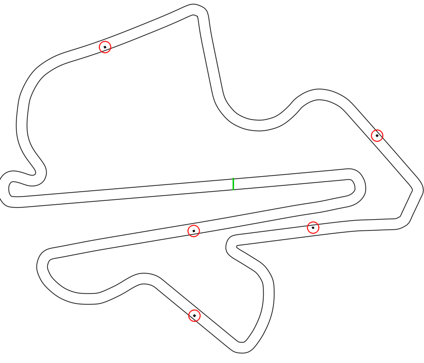

# Parte B: Sepang con 5 obstáculos

**[Español](#español) | [English](#english)**

---

<a name="español"></a>
# Español

Objetivo: agregar **5 obstáculos** a la pista de Sepang y que el robot dé **10 vueltas consecutivas sin colisión** con el controlador Follow the Gap (`gap_node`).

- El mapa original **no se modificó**: `Sepang_map.png` / `Sepang_map.yaml` siguen igual.
- Se creó un mapa nuevo: `Sepang_obs_map.png` / `Sepang_obs_map.yaml`.
- `gap_node` es el mismo de la parte anterior, sin cambios.

La instalación del entorno (ROS 2 Humble, F1TENTH gym, dependencias) está en el [README principal](README.md), pasos 1 a 3.



*Obstáculos en círculos rojos; línea verde = línea de inicio.*

## 1. Cómo se agregaron los obstáculos

1. Se recorrió una vuelta completa de Sepang con `gap_node` y se guardó la trayectoria del carro (475 m por vuelta).
2. Se eligieron 5 puntos repartidos en la vuelta, en **rectas** (sin curvas cerradas) y lejos de la línea de inicio: a 76, 159, 224, 270 y 363 m desde la salida.
3. En cada punto se midió el ancho de la pista (unos 2.5 m) y se dibujó un cuadrado negro (ocupado) de **0.5 × 0.5 m**, alineado con la pista, a **0.4 m de una pared**. Los lados se alternan para obligar al carro a cambiar de carril.
4. Cada obstáculo deja **unos 1.6 m** libres del otro lado para pasar (el carro mide 0.31 m de ancho).

| # | Centro (x, y) [m] | Lado de la pista | Paso libre |
|---|---|---|---|
| 1 | (-9.70, -11.52) | izquierdo | 1.60 m |
| 2 | (-9.53, -32.32) | derecho | 1.54 m |
| 3 | (19.57, -10.70) | izquierdo | 1.62 m |
| 4 | (35.26, 11.90) | derecho | 1.62 m |
| 5 | (-31.48, 33.63) | izquierdo | 1.60 m |

"Izquierdo" y "derecho" son respecto al sentido de la marcha.

El mapa se genera con el script `src/f1tenth_gym_ros/maps/add_obstacles.py`, que lee el mapa original y escribe el nuevo:

```bash
cd ~/F1Tenth-Repository/src/f1tenth_gym_ros/maps
python3 add_obstacles.py
```

Para mover, agregar o cambiar el tamaño de los obstáculos, edita la lista `OBSTACLES` o `SIZE` en el script, ejecútalo de nuevo y recompila (paso 3).

## 2. Archivos

| Archivo | Descripción |
|---|---|
| `src/f1tenth_gym_ros/maps/Sepang_map.png` / `.yaml` | mapa original (sin cambios) |
| `src/f1tenth_gym_ros/maps/Sepang_obs_map.png` / `.yaml` | mapa con los 5 obstáculos |
| `src/f1tenth_gym_ros/maps/add_obstacles.py` | script que genera el mapa con obstáculos |
| `src/f1tenth_gym_ros/config/sim.yaml` | elige el mapa (`map_path`) |
| `docs/sepang_obs_preview.png` | imagen del mapa con los obstáculos marcados |

## 3. Elegir el mapa con obstáculos

En `src/f1tenth_gym_ros/config/sim.yaml`, `map_path` debe terminar en `Sepang_obs_map` (sin extensión):

```yaml
map_path: '/home/<tu_usuario>/F1Tenth-Repository/src/f1tenth_gym_ros/maps/Sepang_obs_map'
map_img_ext: '.png'
sx: 0.0
sy: 0.0
stheta: 0.0
```

Para volver a la pista original, cambia el final a `Sepang_map`. Después de cualquier cambio en `sim.yaml` hay que recompilar:

```bash
cd ~/F1Tenth-Repository
source /opt/ros/humble/setup.bash
colcon build
source install/setup.bash
```

## 4. Correr la simulación y la prueba

**Terminal 1: simulador**

```bash
cd ~/F1Tenth-Repository
source /opt/ros/humble/setup.bash
source install/setup.bash
ros2 launch f1tenth_gym_ros gym_bridge_launch.py
```

Espera a que RViz muestre la pista con los obstáculos, el carro y la línea de inicio verde.

**Terminal 2: controlador**

El carro debe estar sobre la línea verde. Si no lo está, usa **2D Pose Estimate** en RViz: clic sobre la línea verde y arrastra hacia la derecha (+x).

```bash
cd ~/F1Tenth-Repository
source /opt/ros/humble/setup.bash
source install/setup.bash
ros2 run controllers gap_node
```

El carro da 10 vueltas y se detiene solo (unos 14 minutos). Al terminar, la terminal muestra el resumen con los datos de cada vuelta, la vuelta más rápida, la más lenta, el tiempo y la distancia total, la velocidad promedio y máxima, y las casi-colisiones.

En RViz, la trayectoria de la vuelta actual se dibuja en rojo y se reinicia en cada cruce de la línea de inicio.

### Criterio de aprobación

| Criterio | Objetivo |
|---|---|
| Vueltas | 10 consecutivas |
| Colisiones | ninguna (`Near-collisions: 0` en el resumen) |

## 5. Resultados

Prueba completa en el simulador (`Sepang_obs_map`, `gap_node` con sus parámetros por defecto, 18-nov-2026):

| Criterio | Resultado |
|---|---|
| Vueltas consecutivas | **10/10** |
| Casi-colisiones (lectura del LiDAR < 0.20 m) | **0** |
| Contactos con paredes u obstáculos | **0** (verificado comparando la posición del carro con el mapa durante toda la prueba) |
| Vuelta más rápida | vuelta 5, 82.53 s |
| Vuelta más lenta | vuelta 1, 84.60 s |
| Tiempo / distancia total | 831.50 s / 4751.8 m |

Resumen impreso por `gap_node` al terminar:

```
  Lap | Time (s) | Dist (m) | Avg (m/s) | Max (m/s) | Near-coll | Status
  --------------------------------------------------------------------------
    1 |    84.60 |    475.2 |      5.62 |      8.99 |         0 | TOO SLOW  <-- SLOWEST
    2 |    83.34 |    475.0 |      5.70 |      8.89 |         0 | TOO SLOW
    3 |    83.01 |    475.3 |      5.73 |      8.81 |         0 | TOO SLOW
    4 |    82.92 |    475.2 |      5.73 |      8.91 |         0 | TOO SLOW
    5 |    82.53 |    475.5 |      5.76 |      8.86 |         0 | TOO SLOW  <-- FASTEST
    6 |    82.99 |    475.2 |      5.73 |      8.83 |         0 | TOO SLOW
    7 |    82.89 |    475.1 |      5.73 |      8.87 |         0 | TOO SLOW
    8 |    83.16 |    475.1 |      5.71 |      8.91 |         0 | TOO SLOW
    9 |    82.76 |    475.1 |      5.74 |      8.93 |         0 | TOO SLOW
   10 |    83.31 |    475.1 |      5.70 |      8.98 |         0 | TOO SLOW
  --------------------------------------------------------------------------
  Total time:          831.50 s (13.86 min)
  Total distance:      4751.8 m (4.752 km)
  Average speed:       5.71 m/s
  Top speed:           8.99 m/s (lap 1)
  Average lap:         83.15 s (std dev 0.54 s) | average lap distance: 475.2 m
  Laps <= 60 s: 0/10 | laps <= 75 s: 0/10
  Near-collisions:     0
  --------------------------------------------------------------------------
  WINNING LAP (fastest):  lap 5 with 82.53 s (475.5 m, 5.76 m/s average)
  SLOWEST LAP (longest):  lap 1 with 84.60 s (475.2 m, 5.62 m/s average)
  Difference slowest - fastest: 2.08 s
```

El estado `TOO SLOW` solo indica que las vueltas pasan de 75 s; no está relacionado con colisiones. Con obstáculos las vueltas tardan unos 3 s más que en la pista original (≈ 83 s frente a ≈ 80 s).

## 6. Solución de problemas

| Problema | Solución |
|---|---|
| RViz muestra la pista sin obstáculos | `map_path` no apunta a `Sepang_obs_map`, o no se recompiló después de cambiarlo |
| `executable 'gap_node' not found` | compila y haz `source install/setup.bash` |
| El carro no se mueve o queda pegado a una pared | no estaba en la línea de inicio; reinícialo con **2D Pose Estimate** |
| El carro toca un obstáculo | baja `v_max` o sube `safety_margin`: `ros2 run controllers gap_node --ros-args -p v_max:=10.0 -p safety_margin:=0.30` |

---

<a name="english"></a>
# English

Goal: add **5 obstacles** to the Sepang track and have the robot drive **10 consecutive laps without collision** with the Follow the Gap controller (`gap_node`).

- The original map is **unchanged**: `Sepang_map.png` / `Sepang_map.yaml`.
- A new map was created: `Sepang_obs_map.png` / `Sepang_obs_map.yaml`.
- `gap_node` is the same as in the previous part, with no changes.

Environment setup (ROS 2 Humble, F1TENTH gym, dependencies) is in the [main README](README.md), steps 1 to 3.

## 1. How the obstacles were added

1. One full Sepang lap was driven with `gap_node` and the car trajectory was recorded (475 m per lap).
2. 5 points spread along the lap were chosen, on **straight sections** and away from the start line: 76, 159, 224, 270 and 363 m from the start.
3. At each point the track width was measured (about 2.5 m) and a black (occupied) **0.5 × 0.5 m** square was drawn, aligned with the track, **0.4 m from one wall**. Sides alternate so the car has to change lanes.
4. Each obstacle leaves **about 1.6 m** free on the other side (the car is 0.31 m wide).

| # | Center (x, y) [m] | Track side | Free passage |
|---|---|---|---|
| 1 | (-9.70, -11.52) | left | 1.60 m |
| 2 | (-9.53, -32.32) | right | 1.54 m |
| 3 | (19.57, -10.70) | left | 1.62 m |
| 4 | (35.26, 11.90) | right | 1.62 m |
| 5 | (-31.48, 33.63) | left | 1.60 m |

"Left" and "right" are relative to the driving direction.

The map is generated by `src/f1tenth_gym_ros/maps/add_obstacles.py`, which reads the original map and writes the new one:

```bash
cd ~/F1Tenth-Repository/src/f1tenth_gym_ros/maps
python3 add_obstacles.py
```

To move, add or resize obstacles, edit `OBSTACLES` or `SIZE` in the script, run it again and rebuild.

## 2. Select the obstacle map

In `src/f1tenth_gym_ros/config/sim.yaml`, `map_path` must end in `Sepang_obs_map` (no extension). To go back to the original track, change it to `Sepang_map`. Rebuild after any change (`colcon build` and `source install/setup.bash`).

## 3. Run the simulation and the test

```bash
# Terminal 1
cd ~/F1Tenth-Repository && source /opt/ros/humble/setup.bash && source install/setup.bash
ros2 launch f1tenth_gym_ros gym_bridge_launch.py

# Terminal 2 (car on the green start line; use 2D Pose Estimate in RViz if needed)
cd ~/F1Tenth-Repository && source /opt/ros/humble/setup.bash && source install/setup.bash
ros2 run controllers gap_node
```

The car drives 10 laps and stops by itself (about 14 minutes), then prints the summary. Pass criteria: 10 consecutive laps and `Near-collisions: 0`.

## 4. Results

Full simulator test (`Sepang_obs_map`, `gap_node` with its default parameters, Nov 18 2026):

| Criterion | Result |
|---|---|
| Consecutive laps | **10/10** |
| Near-collisions (LiDAR reading < 0.20 m) | **0** |
| Contacts with walls or obstacles | **0** (checked by comparing the car position with the map during the whole test) |
| Fastest lap | lap 5, 82.53 s |
| Slowest lap | lap 1, 84.60 s |
| Total time / distance | 831.50 s / 4751.8 m |

Summary printed by `gap_node` at the end:

```
  Lap | Time (s) | Dist (m) | Avg (m/s) | Max (m/s) | Near-coll | Status
  --------------------------------------------------------------------------
    1 |    84.60 |    475.2 |      5.62 |      8.99 |         0 | TOO SLOW  <-- SLOWEST
    2 |    83.34 |    475.0 |      5.70 |      8.89 |         0 | TOO SLOW
    3 |    83.01 |    475.3 |      5.73 |      8.81 |         0 | TOO SLOW
    4 |    82.92 |    475.2 |      5.73 |      8.91 |         0 | TOO SLOW
    5 |    82.53 |    475.5 |      5.76 |      8.86 |         0 | TOO SLOW  <-- FASTEST
    6 |    82.99 |    475.2 |      5.73 |      8.83 |         0 | TOO SLOW
    7 |    82.89 |    475.1 |      5.73 |      8.87 |         0 | TOO SLOW
    8 |    83.16 |    475.1 |      5.71 |      8.91 |         0 | TOO SLOW
    9 |    82.76 |    475.1 |      5.74 |      8.93 |         0 | TOO SLOW
   10 |    83.31 |    475.1 |      5.70 |      8.98 |         0 | TOO SLOW
  --------------------------------------------------------------------------
  Total time:          831.50 s (13.86 min)
  Total distance:      4751.8 m (4.752 km)
  Average speed:       5.71 m/s
  Top speed:           8.99 m/s (lap 1)
  Average lap:         83.15 s (std dev 0.54 s) | average lap distance: 475.2 m
  Laps <= 60 s: 0/10 | laps <= 75 s: 0/10
  Near-collisions:     0
  --------------------------------------------------------------------------
  WINNING LAP (fastest):  lap 5 with 82.53 s (475.5 m, 5.76 m/s average)
  SLOWEST LAP (longest):  lap 1 with 84.60 s (475.2 m, 5.62 m/s average)
  Difference slowest - fastest: 2.08 s
```

`TOO SLOW` only means the laps are longer than 75 s; it is not related to collisions. With obstacles, laps take about 3 s longer than on the original track (≈ 83 s vs ≈ 80 s).
